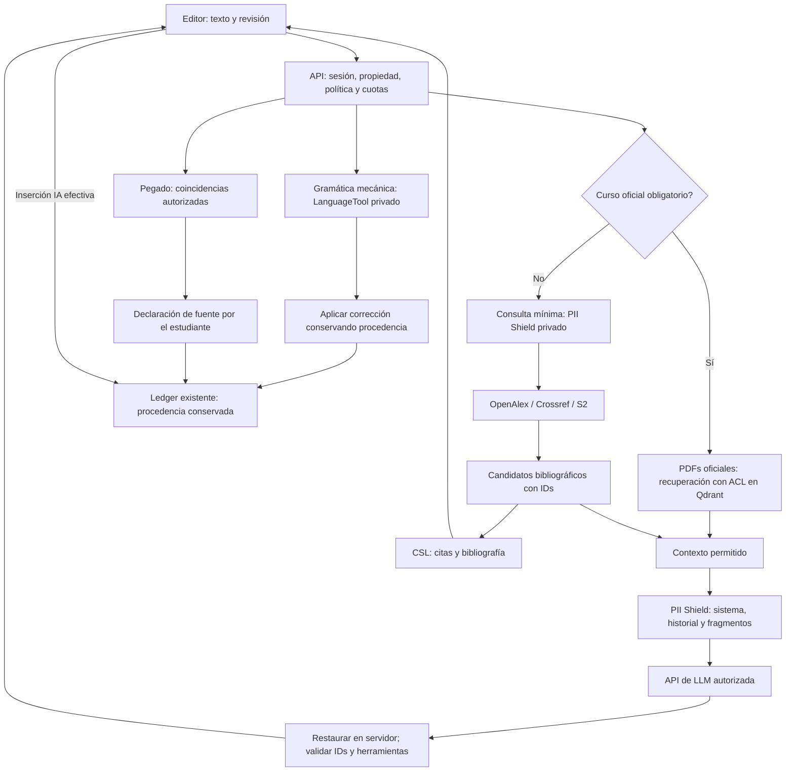

# Motores especializados de Thesisfic

Fecha: 17 octubre 2026. Alcance: arquitectura incremental, contratos de los seis motores y código ejecutable de búsqueda académica y seudonimización. No se ha aprovisionado ningún servicio externo ni desplegado a producción.

## 1. Qué existe y qué cambia

| Motor | Ya existe en el producto | Aportación de esta entrega | Pendiente para integración completa |
|---|---|---|---|
| Fuentes | `lib/scholar.ts`: OpenAlex, Crossref, Semantic Scholar; `ai/citeVerified.ts`: selección de candidatos y comprobación de citas literales; `ai/research.ts`: búsqueda Crossref del chat | `AcademicSearchService`, validación de metadatos, deduplicación DOI, fallos por proveedor y nueva ruta protegida | Conectar Critique/Copilot al nuevo orquestador después de configurar el perímetro privado y las políticas de curso |
| Gramática | `lib/language/languagetool.ts`, ruta `/api/language/check`, extensión de revisión que conserva marcas | Contratos comunes y reglas de integración | Instancia privada/contrato Enterprise; adaptar contrato común si se migra el cliente. La revisión LLM opcional sigue separada |
| Privacidad | No había filtro transversal de PII | Servicio por petición, patrones, identidades conocidas, adaptador Presidio, restauración y bloqueo si falta NER; aplicado en la nueva ruta académica | Instancia privada Presidio con modelos EN/FR/ES; aplicar a TODAS las llamadas de modelo, búsquedas y embeddings; verificar extremo a extremo |
| Atribución | Captura de pegado, fingerprints por frase, coincidencias en fuentes vinculadas y declaración en `/api/sessions/[sessionId]` | Contrato de eventos/resultados y diseño de adaptación | Corpus institucional/MinHash o Compilatio, según contrato. No hay detector de autoría IA |
| Citas | Biblioteca, DOI/Crossref, inserciones y citas verificadas | Contratos CSL, importación y Zotero; diseño de rutas | Procesador CSL/citeproc, estilos versionados, parsers `.bib`/`.ris`, autorización Zotero y cliente |
| RAG | Carga/extracción/chunks de fuentes, BM25 y preguntas sobre fuentes del trabajo | Contratos de corpus oficial, trabajos de indexación y recuperación aislada | Lecturas oficiales por asignatura, cola persistente, embeddings privados, Qdrant y filtro obligatorio por institución/asignatura/versión |

La nueva ruta no sustituye todavía las llamadas existentes del chat. No se afirma que el producto entero esté protegido por Presidio, que citeproc/Zotero estén conectados ni que Qdrant esté aprovisionado. Los contratos nuevos describen la interfaz objetivo; no cambian el formato persistido en `db.ts` ni crean un segundo ledger.

## 2. Organización modular

Se conserva App Router y el acceso a datos exclusivamente a través de `lib/db.ts`. Los clientes académicos existentes siguen siendo la única implementación HTTP de esos proveedores.

```text
src/
  types/engines.ts                        # NUEVO: contratos de los seis motores y eventos
  lib/
    db.ts                                # existente: acceso persistente y autorizaciones de datos
    scholar.ts                           # existente: OpenAlex / Crossref / S2
    services/
      academic-search.ts                 # NUEVO: orquestación + sugerencias estructuradas
      pii-scrubber.ts                     # NUEVO: sesión reversible + adaptador Presidio
      citation-format.ts                 # PROPUESTO: procesador CSL, estilos locales versionados
      reference-import.ts                # PROPUESTO: BibTeX/RIS -> CSL -> biblioteca existente
      zotero.ts                          # PROPUESTO: API v3, paginación, cuotas, credenciales por usuario
      course-corpus.ts                    # PROPUESTO: reglas, publicación y borrado del corpus
    language/languagetool.ts              # reutilizado
    sources/{extract,retrieve}.ts         # reutilizados: extracción, BM25 y fingerprints
    engines/                             # PROPUESTO: adaptadores, sin acceso directo a otro store
      attribution.ts                     # fuentes locales / MinHash / Compilatio
      course-retrieval.ts                 # filtros ACL y cobertura
      qdrant.ts                          # cliente privado, nunca expuesto al navegador
    ai/
      providers.ts                       # frontera actual común de generación
      protected-completion.ts            # PROPUESTO: envolver frontera con PII + restauración SSE
      research.ts                        # existente: conectar al nuevo orquestador en fase posterior
  app/api/
    academic/search/route.ts              # NUEVO y operativo con Presidio privado configurado
    language/check/route.ts               # existente
    sessions/[sessionId]/route.ts         # existente: pegado y declaraciones
    library/references/route.ts           # existente
    citations/format/route.ts             # PROPUESTO
    library/references/import/route.ts    # PROPUESTO
    integrations/zotero/{connect,callback,items}/route.ts # PROPUESTOS
    assignments/[id]/readings/route.ts    # PROPUESTO: corpus oficial, no biblioteca del estudiante
    assignments/[id]/readings/[sourceId]/route.ts # PROPUESTO: eliminación
    course-jobs/[id]/route.ts             # PROPUESTO: estado del trabajo
    course/retrieve/route.ts              # PROPUESTO
```

No crear microservicios para cada endpoint: las operaciones cortas se resuelven en Route Handlers Node. Presidio/LanguageTool/Qdrant son servicios privados independientes. La indexación larga debe ejecutarse en una cola/trabajo durable; nunca iniciar promesas sin esperar en una función HTTP ni guardar trabajos únicamente en memoria.

## 3. Contratos y endpoints

Los tipos concretos están en `src/types/engines.ts`. El cliente nunca decide institución, dueño, procedencia ni contadores. `revision` debe representar la versión real del documento y se compara antes de aplicar una edición; cambio concurrente -> 409, no aplicar sobre posiciones antiguas.

| Ruta | Estado | Contrato y autorización |
|---|---|---|
| `POST /api/academic/search` | Implementada | `{query,limit?:1..20,language?:en/fr/es}` -> `{ok:true,data:{status,papers,providers,suggestions}}`. Sesión obligatoria; respeta activación global y búsqueda; cuerpo máximo 8 KiB; consulta máximo 500 caracteres; `Cache-Control: no-store`. PII conocida tomada de la sesión, NER obligatorio; 503 `privacy_unavailable` si no está configurado. No restaura PII en palabras de búsqueda públicas |
| `POST /api/language/check` | Existente | Conservar contrato actual `{thesisId,paragraphs,includeStyle?,sessionId?}`; propietario y límites existentes. Adaptar a `GrammarRequest/Response` internamente, sin romper cliente |
| `POST /api/sessions/[sessionId]` | Existente | Conservar eventos/consentimiento actuales; usar `PasteMatchRequest/Response` como contrato interno futuro. No enviar pegados a terceros por defecto |
| `POST /api/citations/format` | Propuesta | `CitationFormatRequest -> CitationFormatResponse`; autenticación; estilos y locales en lista permitida, límites de ítems/texto. Bibliografía HTML sanitizada; no cargar CSL/URLs arbitrarias suministradas por el usuario |
| `POST /api/library/references/import` | Propuesta | Multipart `.bib/.ris`, máximo propuesto 2 MiB / 1.000 referencias; parser -> CSL normalizado -> `db.libraryReferences`. Resultado por entrada: importada/duplicada/inválida. Nunca ejecutar comandos BibTeX ni macros |
| `POST /api/integrations/zotero/connect` | Propuesta | Iniciar autorización de biblioteca del usuario, lectura mínima; estado ligado a sesión y retorno permitido |
| `GET /api/integrations/zotero/callback` | Propuesta | Validar estado/credenciales temporales de OAuth 1.0a; cifrar clave por usuario; no devolver secretos al navegador |
| `GET /api/integrations/zotero/items` | Propuesta | Colección/cursor validados, paginación acotada, caché privada y backoff 429; importar ítems seleccionados mediante biblioteca existente. Ninguna URL de proveedor desde el cliente |
| `DELETE /api/integrations/zotero/connect` | Propuesta | Desconectar y borrar credencial local, informar si también hace falta revocarla en Zotero |
| `POST /api/assignments/[id]/readings` | Propuesta | Profesor que gestiona la asignatura o administrador autorizado; multipart PDF con límites, MIME real, escaneo y hash. 202 `{job}`; no 201 listo antes de indexar |
| `GET /api/course-jobs/[id]` | Propuesta | Solo quien puede gestionar la asignatura; estado y error sin contenidos ni stack trace |
| `DELETE /api/assignments/[id]/readings/[sourceId]` | Propuesta | Misma autorización; invalidar corpus inmediatamente, borrar original, chunks, vectores y cachés de forma idempotente |
| `POST /api/course/retrieve` | Propuesta | `CourseRetrieveRequest -> CourseRetrieveResponse`; resolver pertenencia en servidor; no aceptar `institutionId` de JSON como permiso; el asistente llama directamente al servicio, sin auto-HTTP |

No se añade un endpoint público de restauración PII: ampliaría el acceso al mapa reversible. Se restaura en el servidor y solo se responde al dueño de la conversación. Un endpoint de diagnóstico futuro devolvería únicamente tipos y recuentos, jamás valores ni mapa.

En despliegue, aplicar cuotas por usuario/institución y concurrencia con un almacenamiento compartido o firewall antes de habilitar búsquedas masivas. Los timeouts de proveedores están en el cliente existente. No se presenta un contador en memoria de una función como límite distribuido fiable.

## 4. Búsqueda académica y anti-alucinaciones

`AcademicSearchService` reutiliza `openAlexSearch` y `crossrefBibliographic` en paralelo. Si no hay candidatos válidos, prueba el matcher de títulos de S2. Cada fallo queda distinguido de una búsqueda válida sin resultados. Descarta entradas sin DOI válido, título, autores o año y registros marcados como retractados; deduplica DOI sin distinguir mayúsculas.

`verification: indexed_metadata` significa que el registro proviene de un índice académico: no certifica la veracidad del estudio, la coincidencia de una cita literal ni la ausencia universal de retractaciones. Los registros Crossref/S2 que no aporten indicador de retractación no se anuncian como comprobados frente a todos los registros de retractaciones. Las citas literales siguen pasando por `citeVerified.ts` y comprobación de fragmentos.

Flujo objetivo en Critique/Copilot: respetar primero política y configuración; derivar una consulta temática mínima, seudonimizarla, recuperar candidatos y ofrecer IDs cerrados al modelo. El modelo solo puede elegir esos IDs. Al insertar, resolver el ID en el servidor contra el conjunto de candidatos de esa interacción, no aceptar DOI/title arbitrarios devueltos por el modelo. Renderizar CSL a partir de metadatos canónicos. La etiqueta de sugerencia es texto escapado por React, nunca `dangerouslySetInnerHTML`.

Si el curso exige `official_only`, no ejecutar búsqueda pública como fallback: los candidatos salen del corpus oficial y de sus referencias autorizadas. Si faltan fragmentos, explicar la insuficiencia. No transformar un fallo de red en referencias inventadas.

## 5. PII Shield: uso y límites

```ts
// Ejemplo de integración: todavía NO aplicado transversalmente a providers.ts.
const shield = new PIIScrubberService({
  knownNames: [user.name], knownEmails: [user.email],
  analyzer: createPresidioAnalyzer(process.env.PRESIDIO_ANALYZER_URL!),
});
try {
  const systemSafe = await shield.scrub(system, language);
  const messagesSafe = [];
  for (const message of messages) {
    messagesSafe.push({ ...message, content: (await shield.scrub(message.content, language)).text });
  }
  // Aquí llamar al proveedor existente SOLO con systemSafe.text y messagesSafe.
  // El ejemplo usa respuesta completa. Un adaptador SSE debe retener tokens incompletos.
  const response = await completion(systemSafe.text, messagesSafe);
  return shield.restore(response);
} finally {
  shield.dispose();
}
```

No basta con filtrar el último mensaje: cubrir sistema, nombre, título, borrador, selección, historial, fragmentos, herramientas, búsquedas, embeddings y telemetría. No enviar imágenes/PDF originales a un proveedor multimodal sin un tratamiento específico: este servicio cubre texto, no redacción visual de archivos ni metadatos de adjuntos.

El mapa vive únicamente durante la petición; los mismos valores reciben el mismo token dentro de ella, con prefijo aleatorio diferente para cada petición. Se restaura en servidor para que el estudiante vea su respuesta normalmente; no se expone un diccionario de identidades al navegador. En streaming, juntar respuesta o implementar un parser incremental que retenga placeholders partidos antes de enviar SSE; no restaurar cada delta independientemente. Si un modelo altera un placeholder, no adivinar su identidad.

Patrones locales: email, teléfono internacional e identidades conocidas. Presidio: PERSON, EMAIL_ADDRESS, PHONE_NUMBER, LOCATION, IBAN_CODE, CREDIT_CARD e IP_ADDRESS. Convertimos sus offsets Unicode a UTF-16 antes de recortar texto JavaScript. Unimos intervalos solapados para evitar que un reconocedor corto deje visible parte de una entidad mayor.

Por defecto, falta de NER, timeout, respuesta no válida o idioma no soportado por el servicio -> bloqueo; nunca reintentar con el borrador sin filtrar. `requireNER:false` existe para pruebas/uso explícito limitado, no es una garantía de producción. NER puede omitir información y sobredetectar autores bibliográficos: medir corpus EN/FR/ES, definir entidades por institución y revisar falsos negativos/positivos antes de habilitar. Seudonimizar no equivale a anonimizar ni certifica RGPD.

Configuración nueva: `PRESIDIO_ANALYZER_URL`, exclusivamente de servidor, URL fija dentro de la red privada; configurar TLS/mTLS o gateway de acceso. El adaptador admite HTTP para red local; no transportar borradores por Internet sin TLS. El servicio recibe el texto original para analizarlo y forma parte del perímetro de tratamiento, no es una API pública gratuita. No registrar cuerpos, prompts, respuestas ni mapas en proxies/APM.

La región real del despliegue y las condiciones del proveedor siguen siendo relevantes aunque se sustituyan nombres. Para producción: región UE de ejecución, base de datos, backups, logs y procesadores confirmada individualmente; contratos y subencargados, retención/borrado y control de acceso verificados. No se modifica ninguna región ni contrato en esta entrega.

## 6. Gramática, ledger y atribución

Usar LanguageTool para correcciones mecánicas EN/FR/ES; el cliente ya conserva marcas al reemplazar y la ruta no registra interacción IA salvo que se ejecute la capa de estilo LLM. Un texto con marca IA debe conservarla al corregirlo: ni aumentar AI Share por una falta ni convertir una redacción IA en humana. Conservar marca original por segmento en reemplazos que crucen procedencias; el contrato `preserve` expresa esta regla, no autoriza aplicar `human` a todo el párrafo.

No enviar peticiones automatizadas de producto al endpoint público de LanguageTool: su documentación exige instancia propia o Enterprise. La instancia privada mantiene offsets y permite corregir datos personales sin enviarlos a un tercero adicional. No se puede sustituir texto por tokens antes de LT y reutilizar directamente sus offsets sobre el original.

Pegado: reutilizar evento existente -> fingerprints y candidatos autorizados -> coincidencia verificable -> aviso de atribución -> declaración elegida por estudiante. En extensión futura, MinHash/LSH sirve para candidatos de similitud léxica y Qdrant para candidatos semánticos; ninguno prueba por sí solo copia literal ni autoría IA. Confirmar con alineación de texto y conservar fuente, fragmento, página y versión. `unavailable` no equivale a `no_match`; un `no_match` no demuestra autoría original.

No alterar el ledger por mera sospecha ni por búsqueda. El evento de inserción efectiva y las marcas de procedencia existentes son la base del cálculo. Reintentos: idempotencia por usuario/documento/eventId; revisión del documento antes de marcar; el texto del portapapeles no debe almacenarse en logs.

Compilatio requiere verificar previamente contrato, endpoint documentado, retención y permisos para enviar trabajos. No se inventa una URL o una clave de API; el adaptador debe informar `unavailable` mientras no esté configurado.

## 7. CSL, importación y Zotero

Usar citeproc-js con estilos CSL locales versionados APA 7, Chicago author-date, IEEE y un estilo Harvard concreto acordado: Harvard tiene variantes. Guardar CSL JSON canónico y renderizar, sin pedir al modelo que escriba referencias formateadas. Autores se conservan como componentes/literal; no reconstruirlos separando una cadena por comas. Antes de conectar CSL, ampliar el adaptador académico para conservar también la lista estructurada original de autores; el campo de presentación actual no es una fuente CSL suficiente. El formateador responde estilos/locales explícitos y errores por entradas incompletas.

Bibliografía en tiempo real: recalcular al cambiar referencias/estilo; caché por hash de ítems+estilo+locale+versiónCSL. El drag lleva un identificador de referencia y no HTML arbitrario; al soltar resolver permisos y metadatos desde biblioteca existente. Importaciones Bib/RIS: normalizar Unicode/LaTeX admitido, sanitizar HTML/URLs, deduplicar DOI y claves, informar conflictos sin sobrescribir silenciosamente.

Zotero Web API v3 usa claves y OAuth 1.0a para acceso delegado, no asumir OAuth 2.0. Pedir solo lectura de biblioteca necesaria, cifrar secretos y soportar revocación. Importar metadatos; descargar adjuntos únicamente si se solicita y se tiene permiso. Paginación y límites del proveedor son obligatorios. No conectar bibliotecas de distintos estudiantes mediante una única clave de equipo.

## 8. RAG oficial por asignatura

Reutilizar `Assignment` y permisos existentes (`canManageAssignment`/destinatarios) como ámbito inicial. No inventar una entidad paralela de curso sin migración. Si posteriormente una asignatura contiene varias tareas, introducir `Course` con migración explícita y mantener la relación.

Pipeline: profesor autorizado -> PDF privado con MIME/límite/escaneo -> hash e idempotencia -> registro de trabajo en `db.ts` + outbox durable -> extracción por páginas, límites anti-bomba/OCR controlado -> chunks -> embeddings en perímetro autorizado -> Qdrant -> publicar versión del corpus solo cuando todos los chunks estén listos. Reintentos idempotentes por documento/hash/versión de embedding; la versión previa sigue disponible hasta completar la nueva. Fallos quedan visibles como `failed`.

Payload de cada vector: `institutionId`, `assignmentId`, `sourceId`, `chunkId`, `corpusVersion`, `embeddingVersion`, `page`, `contentHash`, `official:true`. Índices keyword por ámbito, dimensiones/modelo fijos por colección. Resolver ámbito desde sesión, filtrar antes del top-k y volver a verificar autorización de los documentos recuperados; nunca confiar en un filtro enviado por el navegador. Identificadores compuestos/hash impiden colisiones entre instituciones.

`official_only` recupera solo esos chunks, devuelve citas página/fuente y declara insuficiencia cuando no hay contexto. No fallback a otra asignatura ni a Internet. PDFs y fragmentos son datos no confiables, nunca instrucciones; herramientas y secretos quedan fuera del contexto recuperado. BM25 existente puede mantenerse como recuperación léxica complementaria dentro del mismo ámbito.

Borrado y baja: invalidar versión/ACL inmediatamente y eliminar vectores, texto, originales y cachés en segundo plano con reintentos; política explícita para backups. El estudiante recibe los pasajes que necesita, no credenciales ni el corpus completo.

## 9. Flujo de datos objetivo



Es el flujo objetivo, no una afirmación de que todas las flechas estén desplegadas. Implementado nuevo: servicio académico, servicio PII, contratos y endpoint académico con protección NER. Reutilizado: LT, pegado/declaración, metadatos y recuperación BM25. La integración transversal del chat, CSL/Zotero y corpus vectorial son fases siguientes.

## 10. Verificación y habilitación

Pruebas sin red: `node scripts/test-specialized-engines.cjs`. Cubren metadatos incompletos/retractados, DOI duplicados, fallos parciales/totales, S2 fallback, NER obligatorio, solapamientos, Unicode astral/offsets Presidio, aislamiento y destrucción del mapa. No prueban precisión real de NER ni afirman conexión a servicios no aprovisionados.

Antes de habilitar el flujo completo: pruebas con proveedores de ensayo, corpus multilingüe de PII, aislamiento entre dos instituciones, edición concurrente, pegado/corrección con marcas mixtas, SSE con tokens partidos, errores de NER/embeddings, bibliografía CSL de referencia, revocación Zotero, borrado de corpus y ausencia de PII en logs. Mantener búsqueda pública bloqueada cuando `official_only` esté activo.

## Fuentes técnicas oficiales

- [OpenAlex: búsqueda de works](https://docs.openalex.org/api-entities/works/search-works) y [autenticación](https://help.openalex.org/api/authentication/).
- [Crossref REST API](https://www.crossref.org/documentation/retrieve-metadata/rest-api/) y [Semantic Scholar API](https://api.semanticscholar.org/api-docs/).
- [Presidio Analyzer](https://data-privacy-stack.github.io/presidio/analyzer/).
- [LanguageTool: condiciones de API pública](https://dev.languagetool.org/public-http-api.html).
- [citeproc-js](https://citeproc-js.readthedocs.io/en/latest/) y [Zotero Web API v3](https://www.zotero.org/support/dev/web_api/v3/basics).
- [Qdrant: multitenancy](https://qdrant.tech/documentation/examples/multitenancy/).
